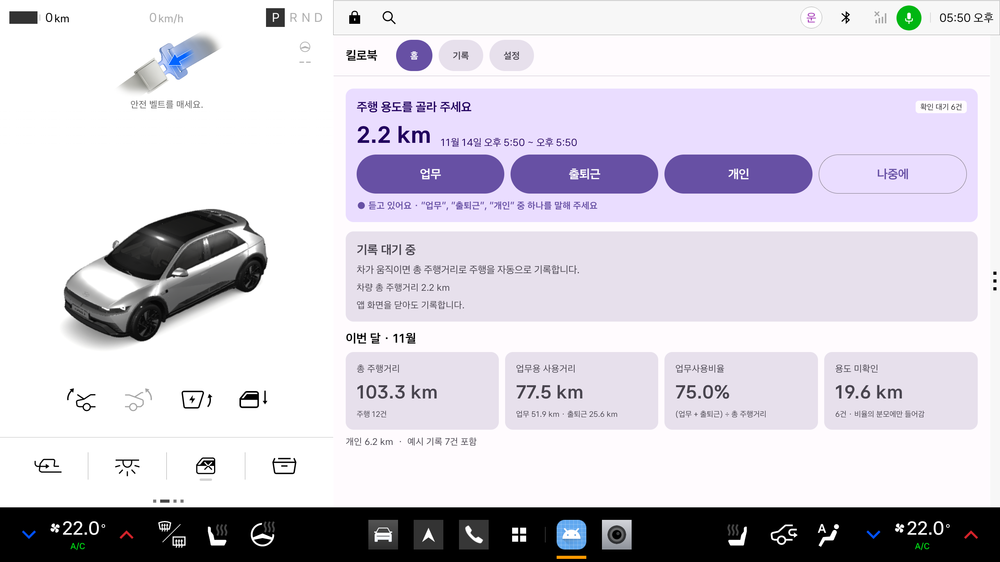
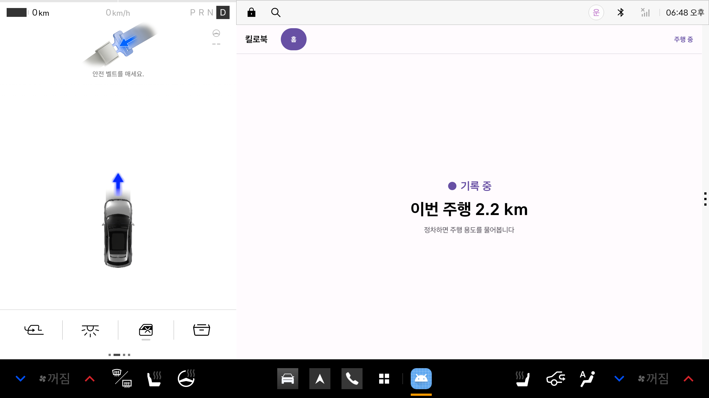

# 킬로북 (KiloBook)

## 1. 앱 이름 및 한 줄 소개

**킬로북 (KiloBook)** — 차량이 직접 읽은 총 주행거리(계기판 값)로 업무용 운행기록을 자동으로 남기고, 운전자는 주행이 끝난 뒤 용도(업무 / 출퇴근 / 개인)만 고르는 Pleos Connect 차량 화면 앱.

- 주행 시작·종료를 자동으로 기록한다: 총 주행거리가 늘면 시작, 기어 P로 끝. 앱 화면이 없거나 차량이 막 켜진 뒤에도 백그라운드에서 기록한다.
- 정차했을 때만 용도를 한 건씩 묻는다. 주행 중에는 "기록 중 · 이번 주행 X km"만 보인다.
- 정차하면 음성으로 한 번 묻는다: "이번 주행 십이 점 삼 킬로미터, 업무였나요?" (Pleos TextToSpeech). "업무 / 출퇴근 / 개인"이라고 말해 답할 수도 있다 (Pleos SpeechToText). 주행 중에는 말하지 않는다.
- 앱이 꺼져 있던 동안 늘어난 거리는 "기록되지 않은 주행"으로 남겨 빠짐없이 묻는다.
- 이번 달 총 주행거리, 업무용 사용거리, 업무사용비율((업무 + 출퇴근) ÷ 총 주행거리, 국세청 업무용승용차 운행기록부 기준)을 보여 준다.

| 정차: 용도 확인과 이번 달 요약 | 주행 중 |
|---|---|
|  |  |

(캡처의 일부 기록은 디버그 패널의 "예시 기록"이며 화면에 "예시"로 표시된다. 다른 화면: [docs/phase5](docs/phase5/README.md))

## 2. 실행 방법

1. 아래 3의 에뮬레이터와 Virtual Console을 준비한다.
2. APK를 설치하고 실행한다:
   ```bash
   adb install -r apk/KiloBook_KiloBook_release.apk
   adb shell am start -n com.kilobook.app/.MainActivity    # 또는 앱 목록에서 "킬로북"
   ```
   권한 동의 팝업은 없다 (앱에 들어간 권한 10개가 모두 Normal 등급, [docs/permissions.md](docs/permissions.md)).
3. 주행 하나 기록하기 (Virtual Console에서 조작):
   - **Gear → Drive**: 앱이 "● 기록 중" 화면으로 바뀐다.
   - **Odometer**를 지금보다 1 km 늘린다: "이번 주행 1.0 km".
   - **Gear → Park**: "주행 용도를 골라 주세요" 카드가 뜨고, 스피커로 "이번 주행 일 킬로미터, 업무였나요?"가 나온다 → **업무**를 누른다.
     음성으로 답하려면 아래 3의 마이크 설정을 켜고, 질문이 끝난 뒤 7초 안에 "업무"라고 말한다 (카드에 "● 듣고 있어요"가 보이는 동안).
   - **기록** 탭에 날짜별로 남고, **홈**의 "이번 달" 요약에 더해진다.
4. 앱이 꺼져 있던 동안의 거리: 앱을 강제 종료(`adb shell am force-stop com.kilobook.app`)하고 Odometer를 늘린 뒤 앱을 다시 열면, 카드에 "기록되지 않은 주행"으로 나온다.
5. 앱을 열지 않아도 기록하기: 앱을 한 번 연 뒤 에뮬레이터를 껐다 켜고(Cold Boot), 앱을 열지 않은 채 Drive → Odometer +1 → Park → 앱을 열면 그 주행이 카드에 있다.
6. 시험용 화면: **설정 › 디버그 패널 보기**를 켜면 **디버그** 탭이 생긴다. 차량 API 결과와 디버그 로그를 보고, "예시 기록 넣기 / 모두 지우기"로 이번 달 예시 주행 7건을 넣고 뺄 수 있다.

시나리오 전체(S1~S8)와 예상 결과: [docs/spike/phase4-scenarios.md](docs/spike/phase4-scenarios.md)

## 3. 테스트 환경 및 필요한 설정

| 항목 | 값 |
|---|---|
| 에뮬레이터 | **Pleos Connect Emulator v2.1.0**, AVD `Pleos_Connect_v2.1.0` (Android 14 / API 34, 2560×1440). 설정: [Pleos 문서](https://document.pleos.ai/docs/connect/guide/getting-started/application-development/setup-connect-sdk-emulator) |
| Vehicle SDK | `ai.pleos.playground:Vehicle:2.3.2` |
| 음성 SDK | `ai.pleos.playground:TextToSpeech:3.3.1`, `ai.pleos.playground:SpeechToText:3.3.1` (`ON_DEVICE` 모드, 네트워크 불필요) |
| 확인한 화면 | 가로 창(기본)과 세로 창(내비와 1:1 분할) |

**시간대 (한국 표준시)** — 에뮬레이터는 처음에 미 태평양 시간이라 기록 시각이 17시간 이르게 보인다. 한 번 바꾸면 유지된다.

1. `adb shell am start -a android.settings.DATE_SETTINGS` (설정 › 날짜 및 시간)
2. **자동으로 시간대 설정**을 끈다 → **시간대 선택** → 목록 아래쪽 **한국 표준시 (GMT+09:00)**
3. 확인: `adb shell getprop persist.sys.timezone` → `Asia/Seoul`. 바꾸기 전에 열려 있던 앱은 다시 연다.

**Virtual Console (차량 값 조작)**

1. `adb forward tcp:8088 tcp:8088` → 브라우저에서 http://127.0.0.1:8088 ([Pleos 문서](https://document.pleos.ai/docs/pleos-only/app-test-guide/virtual-console-guide))
2. **콘솔 페이지를 열어 둔 채로 시험한다.** 페이지가 3초 넘게 닫혀 있으면 값 변경이 `{"error":"emulator_inactive"}`로 거부된다.
3. **Gear** 버튼(Park / Reverse / Neutral / Drive)으로 기어, **Odometer**로 총 주행거리를 바꾼다. 소수점 값은 터미널에서:
   `curl -X PUT "http://127.0.0.1:8088/vehicle/odometer?traveled_distance_km=12.5"`

**마이크 (음성으로 답하기를 시험할 때만)** — 질문(TTS)은 설정 없이 컴퓨터 스피커로 나온다.

1. 에뮬레이터 툴바 **⋯ (Extended Controls)** → **Microphone** → **Enable Host Microphone Access**를 켜고 **Simulate Insert Headset**은 끈다. 에뮬레이터 버전에 따라 이름이 "Virtual microphone uses host audio input"이다 ([Pleos 문서 "마이크 접근 설정"](https://document.pleos.ai/docs/connect/guide/getting-started/application-development/configure-pleos-connect-emulator)). 에뮬레이터를 다시 켜면 꺼진다.
2. macOS가 마이크 접근을 물으면 허용한다 (시스템 설정 › 개인정보 보호 및 보안 › 마이크에서 Android Studio).
3. 컴퓨터 입력(시스템 설정 › 사운드 › 입력)은 **내장 마이크**로 둔다. 블루투스 이어폰 마이크로는 소리는 들어가지만 인식되지 않았다.

주의

- 에뮬레이터를 다시 켜면 콘솔의 총 주행거리가 0으로 돌아간다 (실제 차에는 없는 일). 앱은 이 값을 새 기준으로 쓰고 기록은 그대로 둔다.
- 재부팅은 `adb reboot` 대신 에뮬레이터 창을 닫고 다시 켠다 (`adb reboot`에서 에뮬레이터가 크래시한 적이 있음). 다시 켠 뒤 `adb forward`와 콘솔 페이지 새로고침을 다시 한다.
- 이 차량 화면에서는 Back 키로 앱이 닫히지 않는다 (앱 안의 라이선스 화면은 Back으로 닫힌다). 다른 앱을 띄우려면 아래 독을 쓴다.
- 로그: `adb logcat -s KiloBook:I`

## 4. APK 파일 위치

[`apk/KiloBook_KiloBook_release.apk`](apk/KiloBook_KiloBook_release.apk) — 서명된 release APK (서명 인증서 `CN=kilobook-dev, O=KiloBook`, 버전 1.1.0). 다시 만드는 법: [apk/README.md](apk/README.md)

## 오픈소스 라이선스

이 앱은 아래 오픈소스 라이브러리를 쓴다. 모두 **Apache License 2.0**으로 쓴다 (https://www.apache.org/licenses/LICENSE-2.0).

- AndroidX (AppCompat 포함), Jetpack Compose (Material 3 포함), Room, Material Components for Android
- Kotlin Standard Library, Kotlin Reflect, kotlinx.coroutines, kotlinx.serialization, JetBrains Java Annotations
- Dagger·Hilt, Gson, Guava ListenableFuture, JSR 305 Annotations, javax.inject, JSpecify, Tink, Error Prone Annotations
- JNA: LGPL-2.1-or-later와 Apache 2.0 중 고르는 이중 라이선스이며, Apache 2.0을 따른다.

Pleos Vehicle SDK, TextToSpeech·SpeechToText SDK, Universal Access는 오픈소스가 아니며 Pleos Playground 이용약관을 따른다.
라이브러리별 버전과 라이선스 전체 목록(138개)은 [docs/open-source-licenses.md](docs/open-source-licenses.md). 앱에서는 **설정 › 오픈소스 라이선스**에 목록과 Apache License 2.0 전문이 있다.

## 직접 빌드하기

- Kotlin + Jetpack Compose · minSdk 28 · targetSdk 35 · 단일 Activity · 패키지 `com.kilobook.app`
- 툴체인: AGP 8.8.2 · Gradle 8.10.2 · Kotlin 2.0.0 (공식 샘플 앱과 동일). JDK 17 또는 21이 필요하다 (Gradle 8.10.2는 JDK 25에서 실행되지 않음).
- 이름이 들어가는 빌드 값(패키지, 표시 이름, 제출 APK 파일명, 서명 인증서 이름)은 모두 [`app.properties`](app.properties) 한 곳에서 온다.

```bash
export JAVA_HOME="$(/usr/libexec/java_home -v 17)"   # macOS. 다른 OS는 JDK 17/21 경로
export ANDROID_HOME="$HOME/Library/Android/sdk"     # Android Studio 기본 SDK 위치

./gradlew installDebug                              # 디버그 빌드 설치
./gradlew :app:testDebugUnitTest                    # 단위 테스트 (음성 문장·답 해석)
./gradlew releaseApk                                # 서명된 release APK → apk/ (서명 값 필요, apk/README.md)
```

`local.properties`(git 제외)에 `sdk.dir`을 적어두면 `ANDROID_HOME` 없이도 된다.
Android Studio에서는 Settings › Build Tools › Gradle › Gradle JDK를 JDK 17/21로 맞춘다.

## 구조

```
app.properties                 앱 이름 설정 (appName, appNameEn, appSlug, appIdSuffix, teamName)
scripts/create-release-key.sh  release 서명 키 생성 (저장소 밖)
scripts/git-hooks/             커밋·push 전 작성자와 공동 작성자 줄 검사 (.git/hooks에 복사해서 씀)
apk/                           제출용 release APK 위치
app/src/main/java/com/kilobook/app/
├── KiloBookApp.kt             Application: DB, 설정, 기록 세션을 한 곳에서 만듦
├── AppLog.kt                  logcat과 화면 디버그 로그에 함께 남기는 로그 (최근 300건, 연속 중복은 묶음)
├── DisplaySettings.kt         화면 설정 (음성 안내, 음성으로 답하기, 디버그 패널 보기, 저장됨)
├── MainActivity.kt            Compose 화면을 띄우는 단일 Activity (onStart/onStop을 ViewModel에 전달)
├── DashboardViewModel.kt      화면 쪽 기록 세션 소유자, 버튼 동작, 주행 중 판단, 예시 기록, 음성 질문 연결
├── speech/
│   ├── VoiceAssistant.kt      정차 시 음성 질문 한 번: 오디오 포커스 → 200 ms 묵음 → 질문 → 답 듣기 → 포커스 반환
│   ├── VoiceOutput.kt         Pleos TextToSpeech (ON_DEVICE)
│   ├── VoiceInput.kt          Pleos SpeechToText (ON_DEVICE), 한 번 듣고 마이크 끔
│   ├── VoiceFocus.kt          오디오 포커스 요청·반환, 상실 처리, 통화 중 확인
│   └── VoicePrompts.kt        질문 문장(거리를 한국어 수사로), 답을 용도로 바꾸기
├── ui/
│   ├── MainScreen.kt          탭(홈/기록/설정/디버그)과 주행 중 화면 전환
│   ├── HomeScreen.kt          용도 확인 카드(한 건씩), 기록 상태, 이번 달 요약, 주행 중 화면
│   ├── TripListScreen.kt      날짜별 기록 목록, 목록에서 용도 고르기
│   ├── SettingsScreen.kt      음성 안내·음성으로 답하기·디버그 패널 스위치, 오픈소스 라이선스, 앱 정보
│   ├── LicensesScreen.kt      오픈소스 라이선스 목록 + Apache 2.0 전문 (assets/licenses/)
│   ├── DebugScreen.kt         실시간 값·API 결과, 기록 상태·디버그 설정, 예시 기록, 상세 목록, 디버그 로그
│   ├── Components.kt, Format.kt  공통 카드·버튼, 거리·시각 표시 형식
│   └── theme/KiloTheme.kt     글자·버튼 크기 (Pleos 디자인 가이드 기준)
├── data/
│   ├── Trip.kt                Trip, AppState (Room 엔티티)
│   ├── KiloBookDatabase.kt    Room DB와 DAO (버전 2, 1→2 마이그레이션)
│   ├── MonthSummary.kt        이번 달 요약 (업무사용비율 계산)
│   └── SampleTrips.kt         디버그용 예시 기록
├── recorder/
│   ├── TripRecorder.kt        주행 기록 규칙 1~6, 재시작 시 열린 Trip 정리
│   ├── RecordingSession.kt    화면과 서비스가 함께 쓰는 기록 세션 (소유자 수를 셈)
│   └── RecorderSettings.kt    디버그 설정 (무변화 N분, 재시작 기준, 대체 규칙 강제, 백그라운드 기록)
├── service/
│   ├── RecorderService.kt     Foreground Service: 화면이 없어도 기록 세션 유지
│   └── BootReceiver.kt        BOOT_COMPLETED 수신 시 서비스 시작 (S8), 마지막 결과 저장
└── vehicle/
    ├── DashboardState.kt      차량 상태 (값 + Capability 결과)
    ├── VehicleMonitor.kt      두 소스를 하나의 StateFlow로 합침
    ├── PleosVehicleSource.kt  Pleos Vehicle SDK (Odometer, deprecated Gear)
    └── CarStandardSource.kt   AAOS 표준 API (CarPropertyManager, CarUxRestrictionsManager)
```

## 문서

- [CLAUDE.md](CLAUDE.md) — 인수인계: 현재 상태, 확정된 결정, 작업 규칙, 남은 일, 새 PC 세팅 순서
- [Phase 5 — 제출용 화면, 크기 기준, 시험 결과](docs/phase5/README.md)
- [스파이크 기록 (Phase 1~4, 시나리오 S1~S8)](docs/spike/README.md)
- [권한 점검](docs/permissions.md) — 선언한 권한과 보호 수준 (Normal·Dangerous만 사용)
- [오픈소스 라이선스](docs/open-source-licenses.md)
- [Phase 7 — 음성 용도 확인 (TTS/STT), 시험 결과](docs/phase7/README.md)
- [TTS/STT 동작 확인과 계획 (Phase 7 이전)](docs/speech-check.md)
- [Pleos 문의 목록](docs/pleos-questions.md)

`reference/`에는 공식 샘플 앱을 받아 두며 git에 포함하지 않는다.
